<div align="center">

# 🧬 Artist Neural Sculptures

### Oscillator colonies that learn, remember, predict and act — a visual journey from synchrony to active inference

   

[](LICENSE.md)    

[](https://codespaces.new/shiroonigami23-ui/Artist-Neural-Sculptures?quickstart=1) [](https://github.com/shiroonigami23-ui/Artist-Neural-Sculptures/archive/refs/heads/master.zip)

[**Overview**](#-overview) · [**Features**](#-features) · [**Architecture**](#-architecture) · [**Getting Started**](#-getting-started) · [**Roadmap**](#-roadmap)

</div>

---

## 📸 Preview

<p align="center">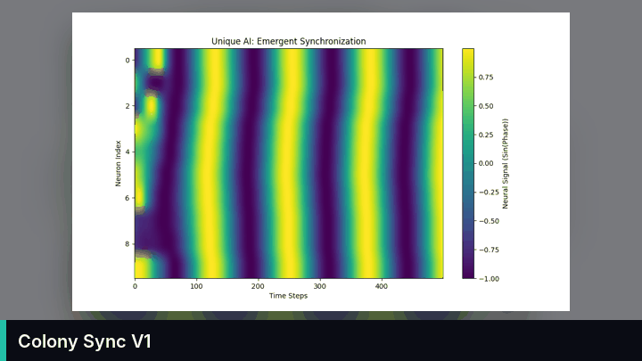</p>

## 📖 Overview

**Artist Neural Sculptures** is an experimental research series that grows a brain-inspired system step by step. It starts with **10 coupled oscillators** finding a shared rhythm, then adds noise resilience, **Hebbian learning**, **associative memory**, a 10×10 **neural canvas**, pruning into a 92 %-sparse sculpture, **temporal prediction**, **prediction-error** surprise signals, **motor tracking** (active inference), **selective attention**, **dopamine-modulated plasticity** and metabolic constraints. Each stage is documented by a visualisation.

### ✨ Highlights

- **14 stages** from synchrony to reward-driven behaviour
- **92 % sparse** pruned architecture
- **Active inference** — the system moves to track targets

## 🧩 Features

| Feature | What it does |
|---|---|
| **Synchronization** | Coupled oscillators converge |
| **Hebbian learning** | Co-active links strengthen |
| **Associative memory** | Store and recall rhythmic patterns |
| **Neural canvas** | Emergent 2D patterns on a grid |
| **Pruning** | Experience-carved sparse structure |
| **Prediction & surprise** | Anticipation and prediction-error spikes |
| **Motor tracking** | Act to reduce error |
| **Dopamine reward** | Reward-modulated plasticity |

## 🛠 Tech Stack

| Layer | Technology |
|---|---|
| Language | Python (Colab) |
| Numerics | NumPy |
| Visuals | Matplotlib |

## 🏗 Architecture


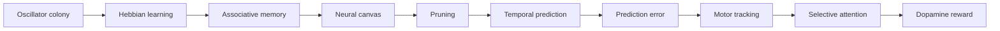

➡️ Full design notes, data flow and design decisions: **[docs/ARCHITECTURE.md](docs/ARCHITECTURE.md)**

## 📁 Project Structure

```text
Artist-Neural-Sculptures/
├── visuals/      # one figure per stage
├── README.md
└── LICENSE.md
```

## 🚀 Getting Started

### 1. Get the code

Pick whichever method suits you:

| Method | Command |
|---|---|
| **HTTPS** | `git clone https://github.com/shiroonigami23-ui/Artist-Neural-Sculptures.git` |
| **SSH** | `git clone git@github.com:shiroonigami23-ui/Artist-Neural-Sculptures.git` |
| **GitHub CLI** | `gh repo clone shiroonigami23-ui/Artist-Neural-Sculptures` |
| **ZIP** | [Download](https://github.com/shiroonigami23-ui/Artist-Neural-Sculptures/archive/refs/heads/master.zip) and extract |
| **Codespaces** | [Open in browser](https://codespaces.new/shiroonigami23-ui/Artist-Neural-Sculptures?quickstart=1) — zero local setup, dev container preconfigured |

> 🔑 **Using SSH for the first time?** Generate a key with `ssh-keygen -t ed25519 -C "you@example.com"`, add the `.pub` contents at **GitHub → Settings → SSH and GPG keys**, then test with `ssh -T git@github.com`.

### 2. Install & set up

```bash
cd Artist-Neural-Sculptures
# no build step required
```

### 3. Run

Open the stages in Google Colab and run them in order. See the evolution table below.

## 🎮 Usage

## Evolution of a Thought
| Stage | Visualization | Description |
| :--- | :--- | :--- |
| **0. Synchronization** | 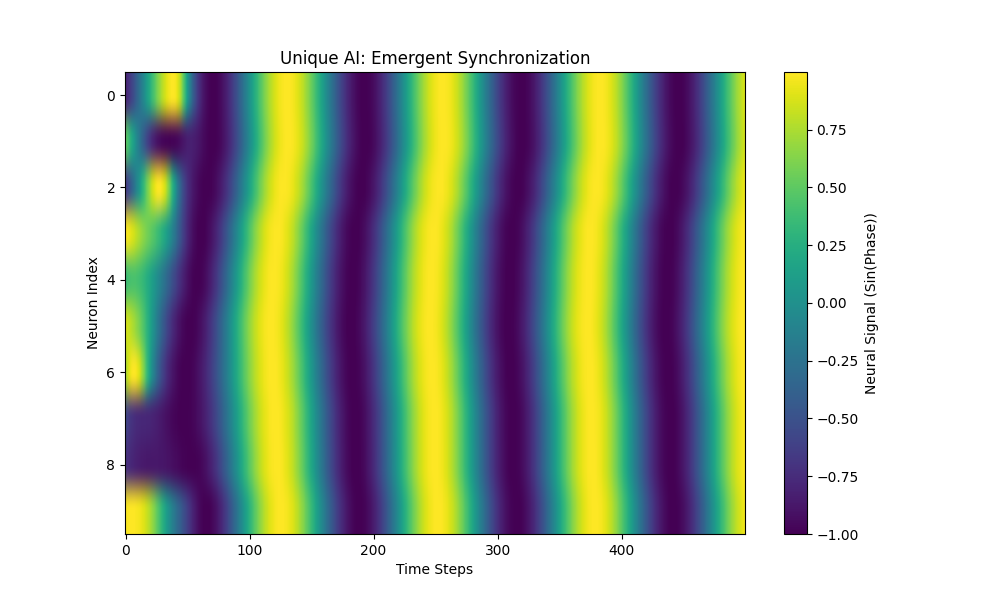 | 10 oscillators finding a shared rhythm. |
| **1. Entropy** | 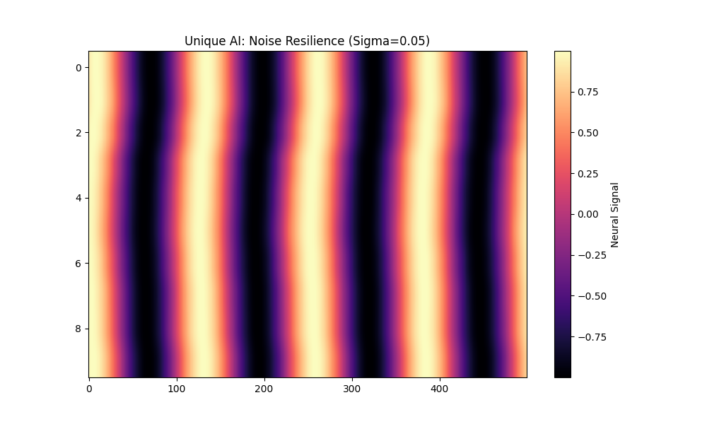 | Resilience to noise with increased coupling. |
| **2. Hebbian Learning** | 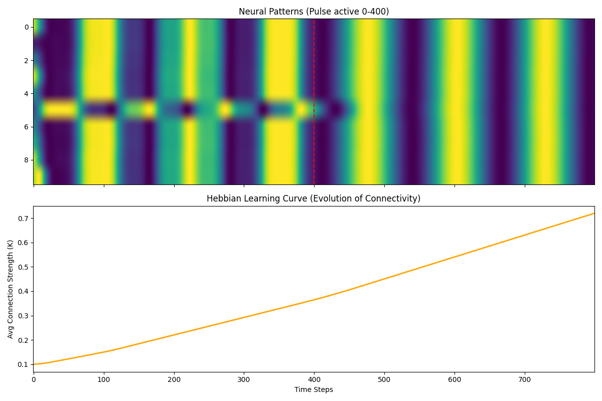 | Connections strengthen based on co-activity. |
| **3. Associative Memory** | 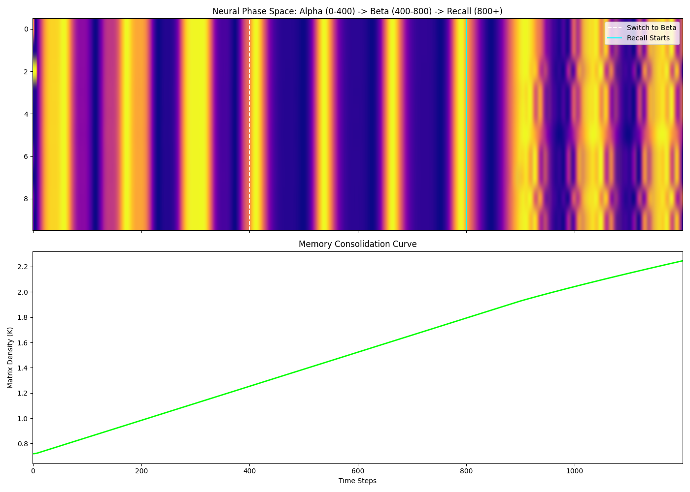 | Learning and recalling multiple rhythmic patterns. |
| **4. Neural Canvas** | 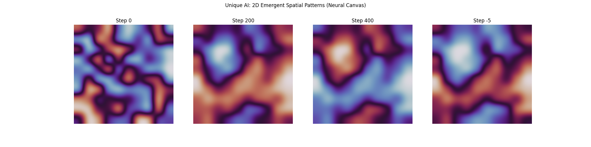 | Emergent 2D spatial patterns in a 10x10 grid. |
| **5. Sculpting Memory** | 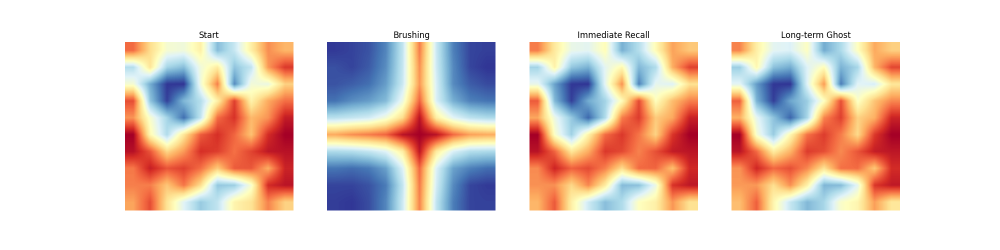 | Imprinting a 'brushstroke' pattern onto the canvas. |
| **6. Pruning Sculpture** | 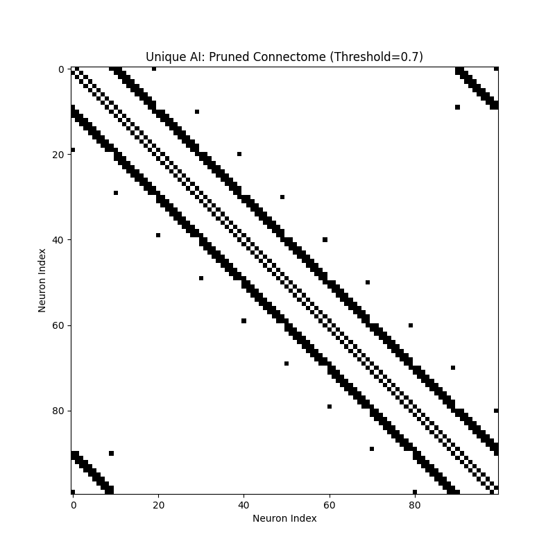 | 92% sparse architecture carved from experience. |
| **7. Temporal Flow** | 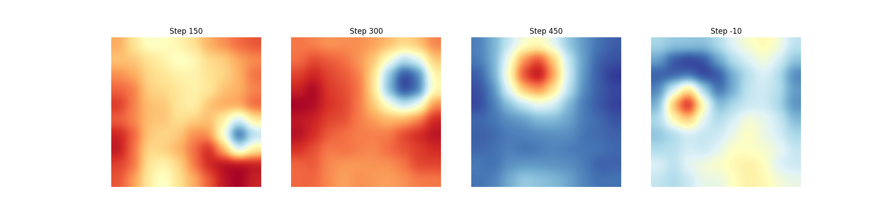 | Navigating the sparse grid with moving stimuli. |
| **8. Anticipation** | 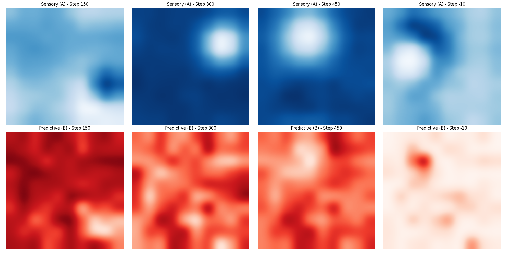 | Layer B 'dreaming' the next state of the comet. |
| **9. Surprise Signal** | 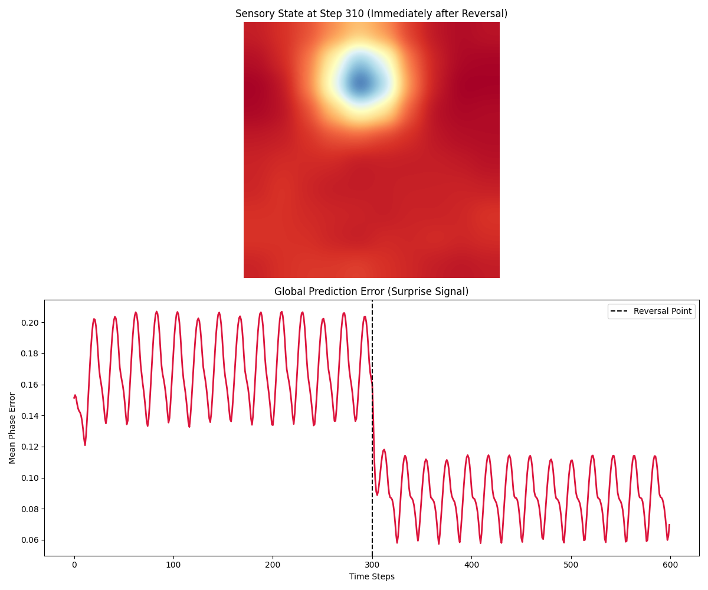 | Detecting reversal spikes via Prediction Error. |
| **10. Motor Tracking** | 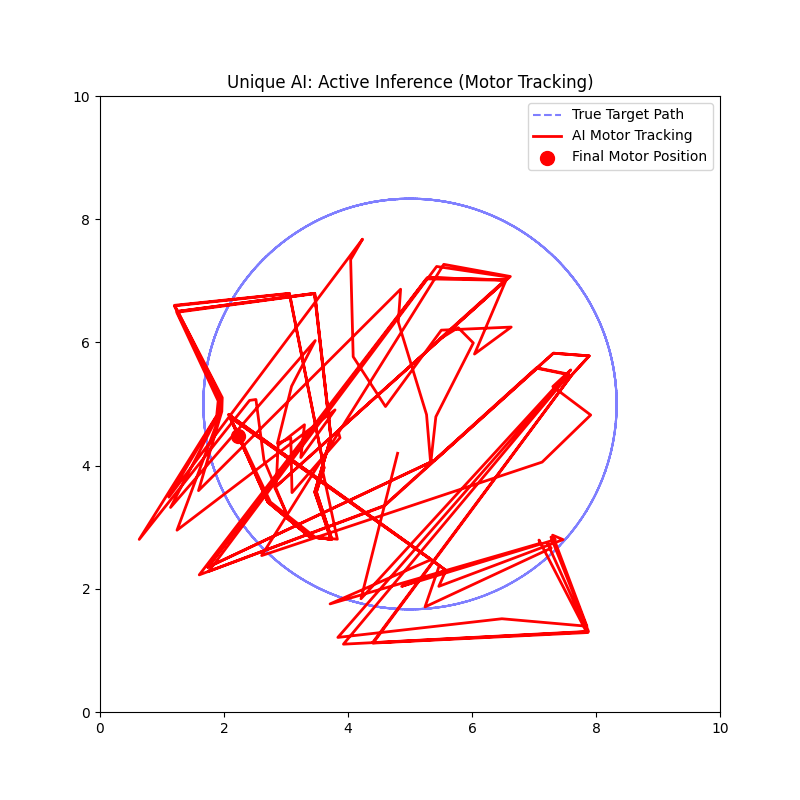 | Active Inference: Moving the 'body' to track targets. |
| **11. Selective Attention** | 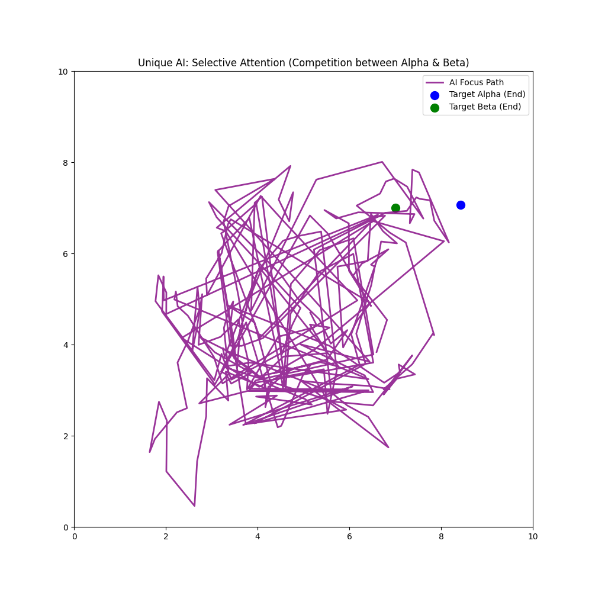 | Preference emergence between competing rhythms. |
| **12. Dopamine Reward** | 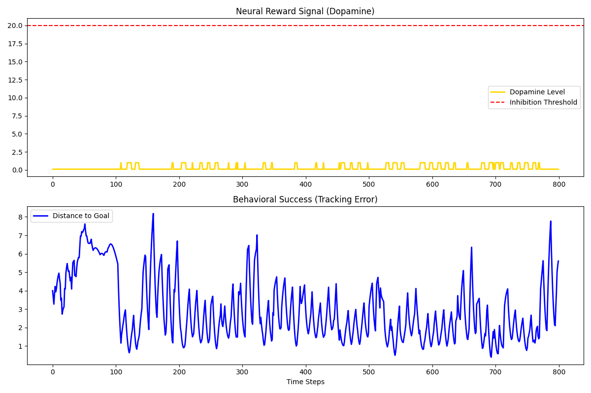 | Reward-modulated plasticity to lock-in behavior. |

## 🗺 Roadmap

**Stages 0–13 (done)**

- [x] Synchrony → reward-modulated plasticity

**Next**

- [ ] Publish the Colab notebooks
- [ ] Animated GIFs for each stage
- [ ] Write-up as a short paper / blog series

➡️ Detailed plan, milestones and long-term vision: **[docs/ROADMAP.md](docs/ROADMAP.md)**

## 🤝 Contributing

Contributions, issues and feature requests are welcome!

1. Fork the repository
2. Create a feature branch: `git checkout -b feature/amazing-feature`
3. Commit your changes: `git commit -m "feat: add amazing feature"`
4. Push the branch: `git push origin feature/amazing-feature`
5. Open a Pull Request against `master`

Check the [issues page](https://github.com/shiroonigami23-ui/Artist-Neural-Sculptures/issues) and the [roadmap](docs/ROADMAP.md) for ideas on where to help.

## 📜 Changelog

See [CHANGELOG.md](CHANGELOG.md) for the release history.

## 📄 License

Distributed under the **Custom (see LICENSE.md)** license. See [LICENSE.md](LICENSE.md) for details.

## 👤 Author

**Aryan Singh Chandel** (Shiro)

[](https://github.com/shiroonigami23-ui)

<div align="center">

⭐ **If you find this project useful, consider giving it a star!** ⭐

</div>
