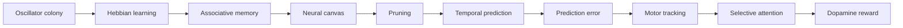

# 🏗 Architecture — Artist Neural Sculptures

> Part of [Artist-Neural-Sculptures](https://github.com/shiroonigami23-ui/Artist-Neural-Sculptures). Back to the [README](../README.md).

## 1. System Overview

Each stage extends the previous model with one new mechanism and produces a figure.

## 2. Components

| Component | Location | Responsibility |
|---|---|---|
| **Figures** | `visuals/` | Stage outputs |

## 3. Data / Control Flow

1. Run stage n.
2. Inspect the figure.
3. Add the next mechanism.

## 4. Key Design Decisions

| Decision | Rationale |
|---|---|
| Incremental design | Each idea isolated and visualised |

## 5. Known Limitations

- Code is Colab-specific (see LICENSE.md)

---
*Last updated: 2026-11-13*
